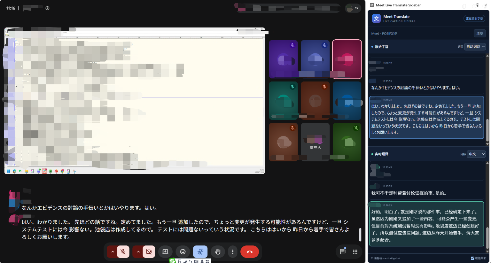

# Meet Live Translate Sidebar (Chrome MV3)

[简体中文](README.md) · [日本語](README.ja.md) · [English](README.en.md)

### 项目简介 / プロジェクト概要 / Project overview

**中文：** Meet Live Translate Sidebar 是一款 Chrome 扩展，捕获 Google Meet 实时字幕，并在浏览器右侧并列显示原文和翻译。支持中、日、英、韩四种语言、发言人区分、字幕修正、去重、单请求最新优先翻译队列、双窗口同步滚动及联动高亮。翻译服务由使用者在本机自行部署；作者的私有 `bridge.py` 和 API Key 不开源。

**日本語：** Meet Live Translate Sidebar は、Google Meet のリアルタイム字幕を取得し、Chrome の右側パネルに原文と翻訳を上下表示する拡張機能です。中国語・日本語・英語・韓国語に対応し、話者表示、字幕の修正追跡、重複防止、最新優先の単一リクエスト翻訳キュー、連動スクロールとハイライト機能を備えています。翻訳用ローカルサーバーは利用者自身で構築してください。作者の非公開 `bridge.py` と API キーは配布しません。

**English:** Meet Live Translate Sidebar is a Chrome extension that captures live Google Meet captions and displays the original text and translation in a right-hand side panel. It supports Chinese, Japanese, English, and Korean, speaker labels, caption corrections, deduplication, a newest-first single-request translation queue, synchronized scrolling, and paired highlighting. Users must provide their own local translation service; the author's private `bridge.py` and API keys are not published.

## 📸 Screenshot / Demo



---

> **Bring your own translation backend.** This repository includes the Chrome extension only. The author's local bridge implementation, model API credentials, and private configuration are **not open-sourced**. Implement your own service using the [Local Translation Bridge API specification](#local-translation-bridge-api).  
> Contact: **riecardx@gmail.com**

## Installation

1. **Build and run a local translation service.** The extension expects a compatible HTTP/JSON server at `http://127.0.0.1:18765`. The author's `bridge.py`, model credentials, and backend implementation are **not published**. Follow the [interface specification](#local-translation-bridge-api).
2. Open `chrome://extensions`, enable **Developer mode**, choose **Load unpacked**, and select the extension's folder.
3. Join a Google Meet meeting and enable **CC / Captions**. Click the extension icon to open Chrome's native right-side panel. You can pin the extension icon for easier access.
4. Set the caption language and translation target (Chinese, Japanese, English, or Korean). `auto` means the translation model automatically detects the source language; it **does not** change the caption-recognition language configured in Google Meet.

## Project files

- `content.js`: monitors live Meet caption DOM nodes and reports updates.
- `background.js`: routes capture events to the side panel and ensures script injection.
- `panel.html`, `panel.css`, `panel.js`: two-pane UI, synchronized navigation, and translation queue.
- **Local Translation Bridge API:** Complete HTTP/JSON protocol, integration examples, safety guidance, and troubleshooting are included **below in this README**. The private `bridge.py` is not included in the public distribution.

## Testing

Test with a real Google Meet meeting with CC captions enabled: short and long utterances, progressively corrected captions, language switching, follow-latest behavior, synchronized scrolling, and switching between meeting tabs. Google Meet's DOM is not a stable public API; syntax checks alone cannot guarantee compatibility.

---

## Local Translation Bridge API

> Project: **Meet Live Translate Sidebar** (Chrome Manifest V3)  
> API specification version: 1.0 (extension v0.1.9)  
> Contact: **riecardx@gmail.com**

### 1. Overview and open-source boundary

The Chrome extension captures **live text captions already displayed in Google Meet**, presents the original text and its translation in two stacked panes of Chrome's right-hand side panel, and manages caption revisions, deduplication, the translation queue, synchronized scrolling, and paired highlighting.

**The translation backend is not part of the publicly released source code.** This repository defines only the **HTTP/JSON contract** between the extension and the user's local translation service. The author's actual `bridge.py`, API keys, cloud model configuration, and other private credentials are not distributed. Users must choose a model provider, obtain and securely store credentials, implement and start their own compatible service, and pay any associated API fees.

**Python and Qwen are not mandatory.** A compatible backend may be written in Python, Node.js, Java, Go, or any other language, and may use a locally hosted model or any cloud translation API. Only the request/response contract described below matters.

Architecture:

```text
Google Meet (CC captions enabled)
  ↓ content.js: caption extraction / version tracking
Chrome extension Side Panel (panel.js)
  ↓ Local HTTP / JSON
http://127.0.0.1:18765
  ↓ Your own local translation bridge (build and operate it yourself)
Your model or third-party translation API (credentials stay on the server)
  ↓ JSON: {"translation":"..."}
Chrome extension displays the translation
```

The extension does **not** request or store any model-provider API key. Authentication with the chosen translation provider is handled by your backend.

### 2. API summary (current extension contract)

| Item | Contract |
| --- | --- |
| Protocol | Local HTTP with JSON |
| Bind address | `127.0.0.1` (loopback only, not exposed to the network) |
| Port | `18765` |
| Base URL | `http://127.0.0.1:18765` |
| Health check | `GET /health` |
| Translation | `POST /translate` |
| Preflight | `OPTIONS /health` and `OPTIONS /translate` |
| Request content type | `application/json` |
| Response content type | `application/json; charset=utf-8` |
| Custom request header | `X-Meet-Translate: chrome-extension` (POST) |
| Encoding | UTF-8 |
| Transport | One HTTP request per translation; **no WebSocket or SSE** in the current client |

**Important:** The endpoint is currently hard-coded in `panel.js`, and its host permission is specified in `manifest.json`. If you change the host, port, or protocol, update both the `fetch()` URL in `panel.js` and `host_permissions` in `manifest.json`. Without these changes, your service must listen at `127.0.0.1:18765`.

### 3. GET /health: availability check

This endpoint verifies that the local service is reachable. The extension checks on startup and approximately **every 15 seconds** afterward. A health check **should not invoke a billable model request**.

#### Request

```http
GET /health HTTP/1.1
Host: 127.0.0.1:18765
Origin: chrome-extension://<your-extension-id>
```

The extension gives this request roughly **1.8 seconds** before timing out, so respond promptly.

#### Successful response

Return `200 OK`. Suggested JSON:

```json
{
  "ok": true,
  "model": "your-model-name"
}
```

Currently the extension only checks whether the HTTP status indicates success. The `model` property is informational and is **not used** to select a translation model. Connection errors, non-2xx responses, and timeouts cause the panel to indicate that the local service is unavailable.

### 4. POST /translate: translation request

#### Request example

```http
POST /translate HTTP/1.1
Host: 127.0.0.1:18765
Origin: chrome-extension://<your-extension-id>
Content-Type: application/json
X-Meet-Translate: chrome-extension

{
  "text": "明日の会議は10時から始まります。",
  "source_lang": "Japanese",
  "target_lang": "Chinese"
}
```

#### Request fields

| Field | Type | Required | Description |
| --- | --- | --- | --- |
| `text` | string | Yes | The **entire current caption text**, not just newly added characters. Meet may revise or append to it and submit a new version |
| `source_lang` | string | Yes (always sent by the extension) | Source language. `auto` delegates detection to your service or model |
| `target_lang` | string | Yes | Destination language |

Accepted language strings:

| UI label | API value |
| --- | --- |
| 中文 | `Chinese` |
| 日本語 | `Japanese` |
| English | `English` |
| 한국어 | `Korean` |
| Auto-detect (source only) | `auto` |

**Values are case-sensitive.** The extension does not send `zh`, `ja`, `en`, or `ko` directly; you may map the received values to those language codes inside your service. The destination language does **not** accept `auto`.

Your independent service may optionally default a missing `source_lang` to `auto` and a missing `target_lang` to `Chinese`, following the author's private implementation. However, the extension supplies both values in normal operation.

#### Successful response: required shape

Return HTTP `200 OK` and JSON:

```json
{
  "translation": "明天的会议从10点开始。"
}
```

`translation` **must be a string**. The extension calls `response.json()` and displays `json.translation`. Do not return only plain text, a Markdown code fence, or the native `choices` array of a model provider. Extra JSON fields are allowed but currently unused.

#### Additional request examples

Auto-detect the source language and translate to Chinese:

```json
{
  "text": "おはようございます。本日の会議を始めます。",
  "source_lang": "auto",
  "target_lang": "Chinese"
}
```

Chinese to Korean:

```json
{
  "text": "请确认系统测试的结果。",
  "source_lang": "Chinese",
  "target_lang": "Korean"
}
```

English to Japanese:

```json
{
  "text": "We will deploy the update tomorrow.",
  "source_lang": "English",
  "target_lang": "Japanese"
}
```

### 5. Errors and validation

Prefer a non-2xx HTTP status code with a consistent JSON error body:

```json
{
  "error": "A brief explanation of the error"
}
```

The author's current private bridge uses the following conventions:

| Status | Typical condition | Recommendation |
| --- | --- | --- |
| `200` | Successful translation | Return `{"translation":"..."}` |
| `204` | Successful CORS preflight | Empty response body |
| `400` | Invalid JSON or fields, unsupported language, empty text | Return `{"error":"..."}` |
| `403` | Origin/source denied by security policy | Reject access |
| `404` | Unknown path | Return an error object |
| `502` | Upstream model API failed | Return an error object |
| `503` | Service temporarily unavailable | Optional implementation |

The author's private implementation also applies the following limits. These are **reference behavior**, not validation performed by the published Chrome client:

- Request `Content-Length`: **1–8192 bytes**.
- `text`: a nonempty string with at most **2000 Python characters**.
- `source_lang`: `auto` or one of the four supported language values.
- `target_lang`: one of the four supported language values.
- If source and target are the same, the service may return the original text without requesting a billable model.
- Upstream model request timeout: approximately **20 seconds**.

The client uses `AbortSignal.timeout(25000)`, a translation timeout of approximately **25 seconds**. If your model routinely needs longer, you must update the client; low latency is strongly recommended for live meetings.

**Failure behavior:** When an updated translation fails, the extension keeps the last successful translation visible if available and displays an error state. It does not repeatedly retry an unchanged caption/language version forever. Return meaningful HTTP errors instead of responding with status `200` but omitting `translation`.

### 6. CORS for a Chrome extension

A panel with origin `chrome-extension://...` calling `http://127.0.0.1:18765` is a cross-origin request. Your local service must correctly respond to CORS requests, including any `OPTIONS` preflight.

Suggested response headers:

```http
Access-Control-Allow-Origin: chrome-extension://<your-extension-id>
Vary: Origin
Access-Control-Allow-Methods: GET, POST, OPTIONS
Access-Control-Allow-Headers: Content-Type, X-Meet-Translate
Content-Type: application/json; charset=utf-8
Cache-Control: no-store
```

Example preflight:

```http
OPTIONS /translate HTTP/1.1
Origin: chrome-extension://<your-extension-id>
Access-Control-Request-Method: POST
Access-Control-Request-Headers: content-type,x-meet-translate
```

Responding with `204 No Content` and the applicable CORS headers is recommended.

**Security note:** `X-Meet-Translate` is an application marker, **not a secret or strong authentication**. Checking `Origin` alone is not sufficient security. The author's private example accepts origins matching the `chrome-extension://...` pattern rather than restricting access to one specific extension ID. Your own implementation should consider an explicit allowlist of installed extension IDs, size limits, rate limits, and other defenses.

Do not unconditionally set `Access-Control-Allow-Origin: *`. Do not bind to `0.0.0.0` and unintentionally expose the service to a LAN or the internet. Even loopback-only services can potentially be abused by other local processes or browser extensions.

### 7. Client-side scheduling and performance

The extension's `panel.js` manages caption IDs and translation versions. **Your backend does not need to understand caption IDs or maintain conversation state.**

Current behavior:

1. Each caption has an independent record and translation version.
2. A new job is created only when the caption content or language selection changes.
3. Updates have approximately **1 second** of stabilization, plus about **90 ms** of same-batch coalescing.
4. There is **at most one HTTP translation request in flight**.
5. The newest eligible waiting caption is prioritized after the current request returns.
6. The pending queue retains up to roughly **6 jobs**, and jobs older than **12 seconds** may be skipped.
7. The previous translation remains visible during a correction and is replaced only when a valid updated response arrives.
8. Outdated responses are discarded rather than overwriting a newer caption version.

These are current client implementation details, not required fields of the backend API, and may change in later releases.

**Important:** `text` contains the **complete latest caption**, not just the characters added since the previous request. Translate each request independently; do not concatenate different requests into one ever-growing transcript.

The client currently uses **non-streaming HTTP/JSON**, not WebSocket, SSE, or a persistent translation session.

### 8. Suggested backend design (not the author's private source)

The following is **pseudocode for illustrating the interface**, not a runnable server and not a copy of the author's private backend:

```text
start_server(host="127.0.0.1", port=18765)

GET /health:
    validate_origin()
    respond_json(200, {"ok": true, "model": configured_model})

OPTIONS /health, /translate:
    validate_origin_and_requested_headers()
    respond_preflight(204)

POST /translate:
    validate_origin()
    validate_content_type_and_custom_header()
    body = parse_json_with_size_limit()
    text = require_nonempty_string(body["text"])
    source = require_language(body["source_lang"])
    target = require_language(body["target_lang"])
    if source == target:
        respond_json(200, {"translation": text})
        return

    secret = load_api_key_from_environment_or_private_config()
    translated = call_your_own_model(text, source, target, secret)
    respond_json(200, {"translation": translated})
```

#### Possible translation backends

- A cloud machine-translation service such as Qwen-MT or another provider.
- A general-purpose LLM prompted to translate without extraneous explanations.
- An open-source translation model running on your computer.
- An internal model gateway for which you have appropriate organizational authorization.

You are responsible for the provider's licensing, pricing, privacy practices, deployment region, and input limits. **Users must obtain their own model accounts and API keys.**

### 9. Running and testing your service

#### 9.1 Start your own local service

Implement and launch your backend so it listens at:

```text
http://127.0.0.1:18765
```

Keep the server running during meetings. The Chrome extension does **not** start a local server for you.

#### 9.2 Verify the health and translation endpoints

Use Postman, Python, or `curl` to test the contract. If your backend enforces an origin allowlist, a request from a terminal **without** an `Origin` header may correctly receive `403 Forbidden`.

```bash
curl -i "http://127.0.0.1:18765/health" \
  -H "Origin: chrome-extension://YOUR_EXTENSION_ID"
```

```bash
curl -i "http://127.0.0.1:18765/translate" \
  -X POST \
  -H "Origin: chrome-extension://YOUR_EXTENSION_ID" \
  -H "Content-Type: application/json" \
  -H "X-Meet-Translate: chrome-extension" \
  --data '{"text":"こんにちは。今日は会議があります。","source_lang":"Japanese","target_lang":"Chinese"}'
```

Expected response:

```json
{
  "translation": "你好。今天有个会议。"
}
```

In Windows PowerShell, prefer `curl.exe` over the `curl` alias, or use `Invoke-RestMethod`. Send requests as UTF-8 so Chinese, Japanese, and Korean text are not corrupted.

#### 9.3 Install and use the Chrome extension

1. Open `chrome://extensions`.
2. Enable **Developer mode**, then click **Load unpacked**.
3. Select this project's extension folder.
4. Enable **CC captions** during a Google Meet meeting.
5. Open the extension's right-side panel.
6. Choose the source and target languages and verify that the local service status indicates a connection.

If `/health` succeeds but translation does not work, inspect `/translate`, CORS preflight, the response JSON, upstream credentials, and your server logs. If no original captions appear at all, first verify Meet's CC setting and the extension's caption DOM detection; that problem is separate from the translation backend.

### 10. Security, privacy, and publishing

1. **Never commit API keys, passwords, tokens, cloud credentials, private configuration, or sensitive logs.**
2. Do not accidentally publish `bridge.py`, local launch scripts, private test utilities, or any other backend code you wish to keep private. A `.gitignore` file is only one safety layer.
3. **Adding `.gitignore` does not untrack previously committed files.** Inspect `git status` and `git ls-files`. Use `git rm --cached` when needed to remove a file from the index without deleting it locally.
4. If credentials have ever appeared in publicly accessible Git history, removing the current file is not sufficient. Rotate affected keys and address the exposed history appropriately.
5. Load secrets from environment variables, an OS credential store, or a private configuration file outside your repository.
6. Bind only to **127.0.0.1**, allowlist authorized extension IDs, enforce input and rate limits, and avoid logging meeting transcripts or secrets.
7. Captions may contain personal data and confidential company information. Using a cloud translation API sends that text to the chosen provider. Obtain appropriate authorization and comply with applicable organizational policies.
8. This project is **not responsible** for third-party model charges, availability, translation accuracy, or data retention policies.
9. For initial public release, create a **clean, dedicated public repository or release directory** containing only the extension and public documentation. Do not publish the entire development folder that includes private files.

### 11. Frequently asked questions

**Q: Do I have to use Qwen?**  
No. Any compatible translation backend that returns the specified JSON is fine.

**Q: Do I need to put an API key inside the extension?**  
No, and you should not. Keep it in your own backend.

**Q: Can I deploy the service to a cloud server?**  
The current client calls `127.0.0.1:18765`. Remote deployment requires changing the client address and permissions and introducing appropriate HTTPS, authentication, and security controls. This document describes a local service by default.

**Q: Why does `/health` work while translations still fail?**  
The health endpoint only checks service reachability. Verify `/translate`, request headers, language values, model credentials, timeouts, and response JSON.

**Q: Why is the same sentence translated multiple times?**  
Meet may append to or correct an in-progress caption. The extension retranslates only when the content/language version changes and discards outdated responses.

**Q: Is there a long-lived WebSocket interface?**  
Not between the extension and the local service in the current version. You may use a model provider's WebSocket interface inside your own backend without changing this client-facing API.

**Q: Why do I temporarily see an older translation?**  
The extension deliberately keeps the last successful translation visible while a revised caption is being translated, preventing distracting blanking or flicker.

### 12. Contact

For questions about the extension, caption capture, API compatibility, or the open-source project, email:

**riecardx@gmail.com**

Do not send API keys, passwords, confidential company meeting transcripts, or other private credentials by email.

---

*This document specifies the interface between the open-source Chrome extension and a local translation service supplied independently by each user. The author's private server implementation and cloud model credentials are not included.*
