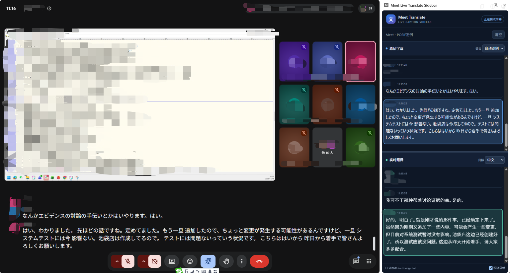

# Meet Live Translate Sidebar（Chrome MV3）

[简体中文](README.md) · [日本語](README.ja.md) · [English](README.en.md)

### 项目简介 / プロジェクト概要 / Project overview

**中文：** Meet Live Translate Sidebar 是一款 Chrome 扩展，捕获 Google Meet 实时字幕，并在浏览器右侧并列显示原文和翻译。支持中、日、英、韩四种语言、发言人区分、字幕修正、去重、单请求最新优先翻译队列、双窗口同步滚动及联动高亮。翻译服务由使用者在本机自行部署；作者的私有 `bridge.py` 和 API Key 不开源。

**日本語：** Meet Live Translate Sidebar は、Google Meet のリアルタイム字幕を取得し、Chrome の右側パネルに原文と翻訳を上下表示する拡張機能です。中国語・日本語・英語・韓国語に対応し、話者表示、字幕の修正追跡、重複防止、最新優先の単一リクエスト翻訳キュー、連動スクロールとハイライト機能を備えています。翻訳用ローカルサーバーは利用者自身で構築してください。作者の非公開 `bridge.py` と API キーは配布しません。

**English:** Meet Live Translate Sidebar is a Chrome extension that captures live Google Meet captions and displays the original text and translation in a right-hand side panel. It supports Chinese, Japanese, English, and Korean, speaker labels, caption corrections, deduplication, a newest-first single-request translation queue, synchronized scrolling, and paired highlighting. Users must provide their own local translation service; the author's private `bridge.py` and API keys are not published.

## 📸 動作デモ



---

> **翻訳バックエンドは各自でご用意ください。** 本リポジトリで公開するのは Chrome 拡張機能のみです。作者のローカル翻訳ブリッジ、モデルの認証情報、非公開設定は公開しません。[本書後半のローカル翻訳 API 仕様](#local-translation-bridge-api)に従って互換サーバーを実装してください。  
> お問い合わせ：**riecardx@gmail.com**

## インストール方法

1. **ローカル翻訳サーバーを自分で実装して起動します。** 拡張機能は `http://127.0.0.1:18765` で稼働する HTTP/JSON 互換サービスを必要とします。作者の `bridge.py`、モデル用の API キー、バックエンド実装は公開しません。[API 仕様](#local-translation-bridge-api)を参照してください。
2. Chrome の `chrome://extensions` を開き、**デベロッパーモード**を有効にして、**パッケージ化されていない拡張機能を読み込む**からプロジェクトフォルダーを選択します。
3. Google Meet の会議に参加して字幕（**CC / Captions**）をオンにし、拡張機能アイコンをクリックします。Chrome 標準の右側サイドパネルが開きます。必要ならアイコンを固定します。
4. 原文言語と翻訳先言語（中国語、日本語、英語、韓国語）を選びます。原文の「自動識別」は翻訳モデルに言語判定を任せる設定であり、Meet 側の字幕認識言語を変更するものではありません。

## 動作・機能・制約

- **v0.1.9 対応行のホバー表示：** 原文・翻訳のどちらかの行にマウスを置くと、双方の対応行をハイライトします。カーソルを外すと解除されます。字幕の改訂で再描画されても対応関係を維持します。クリック時は相手側が 2 回点滅します。
- **v0.1.8 固定操作ボタンの除外：** `arrow_downward 一番下に移動` など Meet のナビゲーション表示を DOM とテキストの両面から除外します。近くにある通常の発言はそのまま取得します。回帰テストは `test_ui_controls.cjs` です。
- **v0.1.7 字幕が空になる問題への対応：** 既知の CSS クラスが使われない画面では、字幕領域内の可視テキスト末端ノードから発言を個別に抽出し、隣接する話者名と組み合わせます。領域内の全文を単一の発言には連結しません。ただし Meet の HTML は変化するため、実際の会議での確認が必要です。
- **v0.1.6 発言単位のグループ化：** Meet の発言・話者ごとに独立したレコードを作ります。同じ話者が後で再び発言しても、新しいメッセージノードがあれば別レコードになります。長文は最大約 200 文字のセグメントに分割し、未確定部分だけが修正されます。メッセージの構造を特定できない場合は、誤って会議全体を連結することを避けます。
- 字幕が追加・訂正された場合、**旧訳は消さず**に「更新中…」と表示し、新訳が返ってから差し替えます。失敗・期限切れのときも既存の読める訳文を保持します。古いリクエストの応答が新しい字幕を上書きすることはありません。
- 原文と翻訳の両方に、Meet が取得可能な話者名（不明なら「未知发言人」）を表示します。対応行は同じ内部 ID を使います。双方向の同期スクロール、クリック時の 2 回ハイライト、ホバー連動に対応します。履歴を手動で閲覧すると最新行への自動追従が一時停止し、最下部へ戻るか「最新を追従」をオフ／オンすると再開します。
- 字幕は Meet ページ上の DOM から取得します。**マイクや音声は録音せず、Qwen ASR も利用しません。** 既知の字幕領域や旧形式のセレクターを使い、必要に応じて拡張機能を既存の Meet タブに注入します。字幕検出状態はサイドパネルに表示します。
- 変更検出には約 **90 ms** の MutationObserver デバウンスと **1 秒**間隔の補助スキャンを使います。字幕レコードごとに原文と翻訳言語の組み合わせを版として保持し、変わらなければ再翻訳しません。
- 更新のあった字幕は約 **1 秒**後（同時期の更新をまとめる追加約 **90 ms**）から翻訳対象になります。同時に実行する翻訳 HTTP リクエストは**最大 1 件**。準備できた最新の字幕を優先し、待機中のタスクは最大約 **6 件**、**12 秒**を超えた古いタスクはスキップされることがあります。
- Google Meet 本体で CC 字幕を有効にする必要があります。認識言語の変更は Meet 側で行ってください。
- サイドパネルが開いている間のみ、最大 **150 件**の字幕レコードをメモリに保持します。ローカルファイルとして会議ログは保存しません。字幕は使用者が選んだ翻訳 API へ送信される場合があります。
- 作者のローカルブリッジは `127.0.0.1` にのみバインドし、拡張機能の Origin と独自ヘッダーを確認します。ローカルサービスは常時起動が必要です。利用者独自のバックエンドではセキュリティ設計を必ず確認してください。
- API キーを含む状態で公開したり、セキュリティレビューなしに Chrome ウェブストアへ公開したりしないでください。

## ファイル構成

- `content.js`：Meet の字幕 DOM を監視して更新を送信します。
- `background.js`：拡張機能内部のメッセージをサイドパネルへ中継します。
- `panel.html`、`panel.css`、`panel.js`：右側の上下 2 ペイン UI と翻訳キューです。
- **Local Translation Bridge API**：本 README の後半に、ローカル API 契約・テスト・セキュリティ・トラブルシューティングをすべて記載しています。非公開の `bridge.py` は公開配布物に含めません。

## 動作テスト

Meet の字幕を有効にした実際の会議で、短い発言、長い発言、逐次修正、翻訳言語の切り替え、最新行の追従、スクロール同期、会議タブの切り替えを確認してください。Meet の DOM は安定した公開 API ではないため、静的な構文テストだけでは完全な互換性を検証できません。

---

## Local Translation Bridge API

> 対象：**Meet Live Translate Sidebar**（Chrome Manifest V3）  
> API 文書バージョン：1.0（拡張機能 v0.1.9 に対応）  
> お問い合わせ：**riecardx@gmail.com**

### 1. 概要と公開範囲

本 Chrome 拡張機能は、**Google Meet のリアルタイム文字字幕**を取得し、ブラウザーの右側に原文と翻訳を上下表示します。字幕の修正、重複排除、翻訳キュー、対応行のスクロール・ハイライトを管理します。

**翻訳バックエンドの実装は公開しません。** このリポジトリが定めるのは、Chrome 拡張機能と利用者のローカル翻訳サービス間の **HTTP/JSON プロトコル**のみです。作者の実際の `bridge.py`、API キー、クラウドモデル設定、その他認証情報は配布しません。利用者はモデル提供元を自分で選定し、API キーを取得・管理し、互換サーバーを実装・起動し、その利用料金を負担してください。

**Python や Qwen の使用は必須ではありません。** Python、Node.js、Java、Go、ローカルのオープンソースモデル、または任意のクラウド翻訳 API を使えます。以下のリクエスト・レスポンス形式を守れば互換性があります。

構成：

```text
Google Meet（CC 字幕をオン）
  ↓ content.js：字幕抽出とバージョン管理
Chrome 拡張機能の Side Panel（panel.js）
  ↓ ローカル HTTP / JSON
http://127.0.0.1:18765
  ↓ 利用者自身が構築したローカル翻訳サービス
任意の翻訳モデル / サードパーティー API（API キーはサーバー側のみ）
  ↓ JSON：{"translation":"..."}
Chrome 拡張機能の翻訳表示
```

拡張機能が第三者モデルの API キーを直接受け取ったり保存したりすることはありません。モデル側の認証と呼び出しはローカルバックエンドが担当します。

### 2. API の全体仕様（現在の実装）

| 項目 | 仕様 |
| --- | --- |
| プロトコル | ローカル HTTP、JSON |
| バインド先 | `127.0.0.1`（ループバックのみ） |
| ポート | `18765` |
| ベース URL | `http://127.0.0.1:18765` |
| ヘルスチェック | `GET /health` |
| 翻訳 | `POST /translate` |
| プリフライト | `OPTIONS /health` と `OPTIONS /translate` |
| リクエストの Content-Type | `application/json` |
| レスポンスの Content-Type | `application/json; charset=utf-8` |
| 独自ヘッダー | `X-Meet-Translate: chrome-extension`（POST） |
| 文字エンコーディング | UTF-8 |
| 通信方式 | リクエスト／レスポンス型。現在 WebSocket／SSE は使用しません |

**重要：** ホスト名とポートは現時点で `panel.js` と `manifest.json` に固定されています。変更するときは `panel.js` の `fetch()` URL と `manifest.json` の `host_permissions` を両方更新してください。

### 3. GET /health：ヘルスチェック

ローカルサービスの稼働状態を確認するエンドポイントです。拡張機能は起動時と、その後約 **15 秒ごと**にチェックします。ヘルスチェックで有料の翻訳 API を呼び出さないでください。

#### リクエスト

```http
GET /health HTTP/1.1
Host: 127.0.0.1:18765
Origin: chrome-extension://<your-extension-id>
```

拡張機能側のタイムアウトは約 **1.8 秒**です。速やかに応答してください。

#### 正常レスポンス

HTTP `200 OK`、推奨 JSON：

```json
{
  "ok": true,
  "model": "your-model-name"
}
```

現在の拡張機能は HTTP が成功したかどうかを判定します。`model` は診断用の任意の情報であり、モデル選択には使用されません。接続失敗、タイムアウト、2xx 以外の応答時にはサービスが利用できない旨を表示します。

### 4. POST /translate：翻訳

#### リクエスト

```http
POST /translate HTTP/1.1
Host: 127.0.0.1:18765
Origin: chrome-extension://<your-extension-id>
Content-Type: application/json
X-Meet-Translate: chrome-extension

{
  "text": "明日の会議は10時から始まります。",
  "source_lang": "Japanese",
  "target_lang": "Chinese"
}
```

#### リクエストフィールド

| フィールド | 型 | 必須 | 内容 |
| --- | --- | --- | --- |
| `text` | string | 必須 | **現時点の字幕全文**。差分文字列ではありません。Meet の認識訂正・追記により再送されます |
| `source_lang` | string | 必須（拡張機能が送信） | 原文の言語。`auto` はサーバー／モデルに自動判定を任せます |
| `target_lang` | string | 必須 | 翻訳先の言語 |

対応する値：

| UI 表示 | API の値 |
| --- | --- |
| 中文 | `Chinese` |
| 日本語 | `Japanese` |
| English | `English` |
| 한국어 | `Korean` |
| 自動判定（原文のみ） | `auto` |

**大文字・小文字を区別します。** `zh`、`ja`、`en`、`ko` をそのまま送る仕様ではありません。独自サービス内でそれらにマッピングすることは可能です。翻訳先には `auto` を指定できません。

自作サービスでの任意の既定値として、`source_lang` 不在時に `auto`、`target_lang` 不在時に `Chinese` を使えます。ただし現行拡張機能は通常、この 2 項目を送信します。

#### 成功レスポンス（必須形式）

HTTP `200 OK`：

```json
{
  "translation": "明天的会议从10点开始。"
}
```

`translation` は**文字列が必須**です。拡張機能は `response.json()` で読み取り、`json.translation` を表示します。プレーンテキスト、Markdown のコードブロック、モデル API の `choices` 配列だけを返さないでください。追加フィールドは構いませんが現行クライアントでは使いません。

#### その他のリクエスト例

原文言語を自動判定して中国語に翻訳：

```json
{
  "text": "おはようございます。本日の会議を始めます。",
  "source_lang": "auto",
  "target_lang": "Chinese"
}
```

中国語から韓国語：

```json
{
  "text": "请确认系统测试的结果。",
  "source_lang": "Chinese",
  "target_lang": "Korean"
}
```

英語から日本語：

```json
{
  "text": "We will deploy the update tomorrow.",
  "source_lang": "English",
  "target_lang": "Japanese"
}
```

### 5. エラーレスポンスと入力検証

2xx 以外の HTTP ステータスと JSON エラーを推奨します。

```json
{
  "error": "A brief explanation of the error"
}
```

作者の非公開実装を参考にしたステータス：

| ステータス | 状況 | 推奨動作 |
| --- | --- | --- |
| `200` | 翻訳成功 | `{"translation":"..."}` |
| `204` | CORS プリフライト成功 | ボディなし |
| `400` | 不正な JSON、フィールド、言語、空の文字列 | `{"error":"..."}` |
| `403` | Origin や要求元の拒否 | アクセス拒否 |
| `404` | エンドポイントなし | エラーを返す |
| `502` | 上流のモデル API の失敗 | エラーを返す |
| `503` | 独自サーバーが一時利用不可 | 任意で実装 |

作者のローカルサービスには次の入力制限があります。**公開クライアント自体の必須検証条件ではなく、互換性を考える際の参考値です。**

- HTTP リクエスト本文の `Content-Length`：**1～8192 バイト**
- `text`：空白のみでない文字列、最大 **2000 Python 文字**
- `source_lang`：`auto` または 4 言語
- `target_lang`：4 言語
- 原文言語＝翻訳先言語の場合は、モデルに課金することなく原文を返して構いません
- 上流モデルへの接続タイムアウトは約 **20 秒**

Chrome 拡張機能側の翻訳リクエストタイムアウトは `AbortSignal.timeout(25000)`、すなわち約 **25 秒**です。それ以上かかるサービスを使う場合はクライアント側も修正してください。

失敗した更新では、以前成功した訳文があれば引き続き表示し、失敗状態を示します。同じ字幕版を際限なく再試行しません。HTTP `200` なのに `translation` がない、といったレスポンスは避けてください。

### 6. CORS：Chrome 拡張機能からのアクセス

`chrome-extension://...` から `http://127.0.0.1:18765` へのアクセスはクロスオリジンです。ローカルサービス側で `OPTIONS` プリフライトと CORS ヘッダーを正しく実装してください。

推奨ヘッダー：

```http
Access-Control-Allow-Origin: chrome-extension://<your-extension-id>
Vary: Origin
Access-Control-Allow-Methods: GET, POST, OPTIONS
Access-Control-Allow-Headers: Content-Type, X-Meet-Translate
Content-Type: application/json; charset=utf-8
Cache-Control: no-store
```

プリフライトの例：

```http
OPTIONS /translate HTTP/1.1
Origin: chrome-extension://<your-extension-id>
Access-Control-Request-Method: POST
Access-Control-Request-Headers: content-type,x-meet-translate
```

`204 No Content` を返す設計を推奨します。

**セキュリティ上の注意：** `X-Meet-Translate` はアプリケーション識別用のヘッダーであり、秘密鍵でも強い認証でもありません。`Origin` だけに依存してアクセスを保護するべきではありません。作者の現在の非公開サンプルは形式上 `chrome-extension://...` の Origin を受け付けますが、特定の拡張機能 ID のみを許すものではありません。ご自身のサービスでは、拡張機能 ID の明示的な許可リストや入力制限などを検討してください。

`Access-Control-Allow-Origin: *` を無条件に使用せず、サーバーを `0.0.0.0` にバインドして LAN やインターネットへ公開しないでください。ループバックのみでも、他のローカルプロセスや拡張機能からの不正利用に注意してください。

### 7. 拡張機能側のキュー処理と性能

字幕 ID とバージョンの管理は `panel.js` 側で行います。**バックエンドは字幕 ID を保存したり、以前のリクエストの文面を連結したりする必要がありません。**

現在の動作：

1. 字幕ごとに独立したレコードと版を保持します。
2. 原文または選択言語が変化したときだけ新たな翻訳候補にします。
3. 約 **1 秒**の安定化待ちと約 **90 ms** の同時更新のまとめ時間を設けます。
4. 同時に実行する翻訳 HTTP リクエストは**最大 1 件**です。
5. 待機中の翻訳は、準備済みの新しい字幕を優先します。
6. キューは最大約 **6 件**、**12 秒**を超えた古い待機タスクはスキップする場合があります。
7. 改訂中も旧訳を維持し、新しい応答が正常に返ってから置き換えます。
8. 既に古くなったレスポンスは捨て、新しい字幕を上書きさせません。

これらは現在のクライアント内部仕様であり、将来のバージョンで変更される場合があります。

**重要：** `text` に送信するのは、その時点の字幕の**全文**です。前回から増えた差分だけではありません。サーバーは毎回の `text` を独立した翻訳対象として扱ってください。

API は非ストリーミング HTTP リクエスト／レスポンス方式です。WebSocket、SSE、持続セッションは必要ありません。

### 8. バックエンドの実装案（作者の非公開コードではありません）

以下は**仕様理解のための擬似コード**です。そのまま実行できる実装ではなく、実際のモデル呼び出しや秘密情報の取り扱いは含みません。

```text
start_server(host="127.0.0.1", port=18765)

GET /health:
    validate_origin()
    respond_json(200, {"ok": true, "model": configured_model})

OPTIONS /health, /translate:
    validate_origin_and_requested_headers()
    respond_preflight(204)

POST /translate:
    validate_origin()
    validate_content_type_and_custom_header()
    body = parse_json_with_size_limit()
    text = require_nonempty_string(body["text"])
    source = require_language(body["source_lang"])
    target = require_language(body["target_lang"])
    if source == target:
        respond_json(200, {"translation": text})
        return

    secret = load_api_key_from_environment_or_private_config()
    translated = call_your_own_model(text, source, target, secret)
    respond_json(200, {"translation": translated})
```

#### 利用できる翻訳モデルの例

- Qwen-MT など、クラウドの機械翻訳 API
- 翻訳指示を使える汎用 LLM
- パソコン内で動かすオープンソース翻訳モデル
- 所属組織から利用許可を受けた社内モデルゲートウェイ

利用するモデルのライセンス、料金、プライバシーポリシー、接続先地域、文字数制限などはご自身で確認してください。**API キーとモデル契約は利用者が準備します。**

### 9. 起動と API の動作確認

#### 9.1 ローカルサービスを起動

利用者が自分の翻訳サーバーを実装して起動し、次の URL で受け付けるようにします。

```text
http://127.0.0.1:18765
```

会議中の翻訳リクエストに対応するには、サービスを起動したままにする必要があります。拡張機能はサーバーを自動起動しません。

#### 9.2 ヘルスチェックと翻訳のテスト

Postman、Python、`curl` などで試せます。Origin の許可リストを設定している場合、Origin ヘッダーがないターミナルからのアクセスは `403` になっても不自然ではありません。

```bash
curl -i "http://127.0.0.1:18765/health" \
  -H "Origin: chrome-extension://YOUR_EXTENSION_ID"
```

```bash
curl -i "http://127.0.0.1:18765/translate" \
  -X POST \
  -H "Origin: chrome-extension://YOUR_EXTENSION_ID" \
  -H "Content-Type: application/json" \
  -H "X-Meet-Translate: chrome-extension" \
  --data '{"text":"こんにちは。今日は会議があります。","source_lang":"Japanese","target_lang":"Chinese"}'
```

期待する応答：

```json
{
  "translation": "你好。今天有个会议。"
}
```

Windows PowerShell では `curl` の別名ではなく `curl.exe` または `Invoke-RestMethod` を推奨します。中国語・日本語・韓国語が文字化けしないよう UTF-8 で送信してください。

#### 9.3 Chrome 拡張機能を導入

1. `chrome://extensions` を開きます。
2. デベロッパーモードをオンにし、解凍済みの拡張機能を読み込みます。
3. 本プロジェクトのディレクトリを選択します。
4. Google Meet で CC 字幕をオンにします。
5. 拡張機能の右サイドパネルを開きます。
6. 原文／翻訳先の言語を選び、ローカルサービス接続の表示を確認します。

ヘルスチェックが成功しても翻訳されない場合は、`/translate`、CORS、JSON レスポンス、モデル API 設定とサーバーログを確認してください。原文字幕そのものが表示されない場合は、Meet の CC と字幕 DOM の検出を先に確認してください。

### 10. セキュリティ・プライバシー・OSS 公開時の注意

1. **API キー、パスワード、認証トークン、秘密設定、機密ログを Git にコミットしないでください。**
2. `bridge.py`、ローカル起動スクリプト、非公開のテストコードなどを公開リポジトリへ誤って追加しないでください。`.gitignore` だけに頼らず公開ファイルを確認してください。
3. **すでに Git で追跡されているファイルは `.gitignore` を追加しても追跡解除されません。** `git status` と `git ls-files` を確認し、必要なら `git rm --cached` でインデックスから削除してください（ローカルファイルは残ります）。
4. 秘密鍵が一度でも Git の履歴に公開された場合、現在のファイルを消すだけでは不十分です。キーを再発行し、公開履歴に適切に対処してください。
5. 秘密情報は環境変数、OS の資格情報ストア、リポジトリ外の非公開設定ファイルなどから読み込んでください。
6. `127.0.0.1` のみで待ち受け、許可する拡張機能 ID、レート制限、リクエスト本文サイズを制限し、字幕本文・秘密鍵をログに出さないようにしてください。
7. 字幕に個人情報や企業秘密が含まれる場合があります。クラウド API を使うとその文字が提供者に送信されます。必ず組織の許可と情報セキュリティポリシーに従ってください。
8. 本プロジェクトはサードパーティーモデルの費用、稼働率、翻訳精度、データ保持ポリシーについて責任を負いません。
9. 初回公開時は、プライベートファイルを含む開発ディレクトリ全体を公開せず、**新しいクリーンな公開用リポジトリ**に必要な拡張機能と公開ドキュメントだけを配置してください。

### 11. よくある質問（FAQ）

**Q：Qwen 以外のモデルも利用できますか？**  
はい。`translation` を含む指定 JSON を返す限り、他のモデルや翻訳エンジンも利用できます。

**Q：Chrome 拡張機能に API キーを設定する必要はありますか？**  
ありません。キーは自作のバックエンドにのみ保管してください。

**Q：クラウドサーバーにデプロイできますか？**  
現行クライアントは `127.0.0.1:18765` に固定されています。クラウド化する場合、URL、権限、HTTPS、認証を設計し直す必要があります。ここでの基本仕様はローカル利用です。

**Q：`/health` は正常なのに翻訳が失敗するのはなぜですか？**  
ヘルスチェックは稼働確認のみです。`/translate`、ヘッダー、言語値、モデルの API キー、タイムアウト、レスポンス JSON を確認してください。

**Q：同じ字幕の翻訳リクエストが繰り返されることがありますか？**  
Meet は発言の認識結果を追記・修正します。原文または言語の版が変わったときだけ再送し、古い版の応答は捨てます。

**Q：WebSocket の長期接続に対応していますか？**  
拡張機能とローカルサーバー間は HTTP/JSON です。バックエンド内部でモデル事業者の WebSocket を使用するのは自由です。

**Q：古い訳文が一時的に表示されるのはなぜですか？**  
字幕の追記で表示が頻繁に消えないよう、更新版が届くまで旧訳を維持する仕様です。

### 12. お問い合わせ

拡張機能、字幕取得、ローカル API 互換性、OSS プロジェクトについてのご連絡：

**riecardx@gmail.com**

API キー、パスワード、企業の機密会議字幕などの情報をメールで送信しないでください。

---

*本書は公開 Chrome 拡張機能と、利用者が別途構築するローカル翻訳サービス間のインターフェース仕様を説明するものです。作者の非公開サーバー実装やモデルの認証情報は提供されません。*
