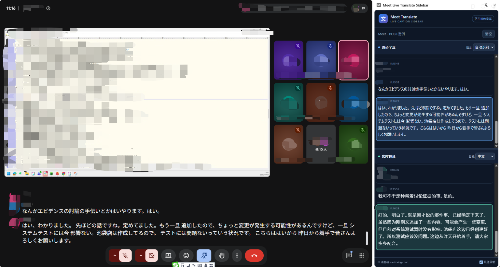

# Meet Live Translate Sidebar (Chrome MV3)

[简体中文](README.md) · [日本語](README.ja.md) · [English](README.en.md)

### 项目简介 / プロジェクト概要 / Project overview

**中文：** Meet Live Translate Sidebar 是一款 Chrome 扩展，捕获 Google Meet 实时字幕，并在浏览器右侧并列显示原文和翻译。支持中、日、英、韩四种语言、发言人区分、字幕修正、去重、单请求最新优先翻译队列、双窗口同步滚动及联动高亮。翻译服务由使用者在本机自行部署；作者的私有 `bridge.py` 和 API Key 不开源。

**日本語：** Meet Live Translate Sidebar は、Google Meet のリアルタイム字幕を取得し、Chrome の右側パネルに原文と翻訳を上下表示する拡張機能です。中国語・日本語・英語・韓国語に対応し、話者表示、字幕の修正追跡、重複防止、最新優先の単一リクエスト翻訳キュー、連動スクロールとハイライト機能を備えています。翻訳用ローカルサーバーは利用者自身で構築してください。作者の非公開 `bridge.py` と API キーは配布しません。

**English:** Meet Live Translate Sidebar is a Chrome extension that captures live Google Meet captions and displays the original text and translation in a right-hand side panel. It supports Chinese, Japanese, English, and Korean, speaker labels, caption corrections, deduplication, a newest-first single-request translation queue, synchronized scrolling, and paired highlighting. Users must provide their own local translation service; the author's private `bridge.py` and API keys are not published.

## 📸 运行效果



---


> **Translation backend is BYO (bring your own).** This repository publishes the Chrome extension only. The local translation bridge, model credentials and private configuration are not open-sourced. Implement a compatible service using [下方本地翻译服务接口说明](#local-translation-bridge-api).
>
> Contact: **riecardx@gmail.com**

## Install
1. **Build and start your own local translation service.** This open-source extension expects a compatible HTTP/JSON service at `http://127.0.0.1:18765`. The author's `bridge.py`, model credentials, and backend implementation are **not published**. See [Local Translation Bridge API](#local-translation-bridge-api).
2. Open `chrome://extensions`, enable Developer mode, click **Load unpacked**, and choose this project folder.
3. Open a Google Meet meeting, turn on **CC / Captions**, and click the extension icon. Chrome opens its native right-side panel. Pin the icon in Chrome for easier access.
4. Set original-caption language and translation target (Chinese/Japanese/English/Korean). 'Auto' means the Qwen model detects the source language, not that the extension changes Google Meet's caption language.

## Files
- `content.js`: watches Meet caption elements and sends updates.
- `background.js`: routes updates to the side panel.
- `panel.html/css/js`: fixed browser right-side split UI.
- **Local Translation Bridge API（本地翻译服务接口说明）**：完整接口约定、安全建议及自建服务方法已合并在本 README 下方。

## Testing
Use a real Google Meet session with captions enabled, speak short utterances and longer sentences; verify incremental revision, translations, language switches, scroll following, and meeting switching. The Google Meet DOM is not stable and cannot be fully verified by syntax-only testing.

---

## Local Translation Bridge API

> 适用项目：**Meet Live Translate Sidebar**（Chrome Manifest V3）  
> 文档版本：1.0 · 对应插件 v0.1.9  
> 项目联系邮箱：**riecardx@gmail.com**

### 1. 说明及开源边界

本 Chrome 扩展负责在 **Google Meet 页面**读取已启用的实时文字字幕、在浏览器右侧并排显示原文与译文，并维护字幕修订、去重、翻译队列、滚动和高亮等交互。

**翻译服务端不属于公开发布的扩展源码。** 本项目只约定插件与本机翻译服务之间的 HTTP/JSON 通信协议，不随公开仓库提供作者实际使用的 `bridge.py`、API 密钥、云模型配置或任何服务端凭据。使用者需要自行选择模型提供商、自行申请并保管 API Key、自行实现并启动兼容服务，并自行承担对应的 API 使用费用。

**不要求使用 Python 或 Qwen。** 你可以使用 Python、Node.js、Java、Go 等实现后端，也可以使用本地模型或任意云翻译服务。只要实现下述接口并返回规定 JSON，插件就能工作。

架构：

```text
Google Meet（开启 CC 字幕）
  ↓ content.js：字幕提取/版本识别
Chrome 扩展 Side Panel（panel.js）
  ↓ HTTP JSON：localhost
http://127.0.0.1:18765
  ↓ 你的本地翻译服务（自行编写和维护）
你的翻译模型或第三方 API（凭据仅保存在服务端）
  ↓ JSON：{"translation":"..."}
Chrome 扩展显示译文
```

插件**不会直接接收或保存第三方模型 API Key**；模型侧的鉴权和调用由使用者自己实现的本地服务完成。

### 2. 接口总览（插件当前实际使用）

| 项目 | 当前约定 |
| --- | --- |
| 协议 | 本机 HTTP，JSON |
| 监听地址 | `127.0.0.1`（只绑定回环地址，不对外网开放） |
| 默认端口 | `18765` |
| 服务根地址 | `http://127.0.0.1:18765` |
| 健康检查 | `GET /health` |
| 翻译 | `POST /translate` |
| 预检 | `OPTIONS /health` 和 `OPTIONS /translate`（支持 Chrome 扩展跨域预检） |
| 请求内容类型 | `application/json` |
| 响应内容类型 | `application/json; charset=utf-8` |
| 扩展自定义请求头 | `X-Meet-Translate: chrome-extension`（POST） |
| 字符集 | UTF-8 |
| 通信方式 | 逐条请求/响应；**当前不使用 WebSocket 或 SSE** |

**注意：** `panel.js` 和 `manifest.json` 目前写死了上述地址。若自行改变主机名、端口或协议，必须同时修改 `panel.js` 的 `fetch()` 地址和 `manifest.json` 中对应的 `host_permissions`。没有改动时，服务必须监听 `127.0.0.1:18765`。

### 3. GET /health：健康检查

作用：检查本地服务是否在运行。插件启动时会检查，之后约每 **15 秒**检查一次，并根据结果提示本机服务状态。健康检查**不应发起真实付费翻译调用**。

#### 请求

```http
GET /health HTTP/1.1
Host: 127.0.0.1:18765
Origin: chrome-extension://<your-extension-id>
```

扩展端目前为该请求设置约 **1.8 秒超时**。请让此接口快速返回。

#### 成功响应

状态码 `200 OK`，建议：

```json
{
  "ok": true,
  "model": "your-model-name"
}
```

当前版本的插件只检查 HTTP 状态是否为成功，并不会依赖 `model` 字段来选择模型。这里的 `model` 用于标识或诊断，实现者可以根据自己的服务填写。

如果服务未启动、拒绝连接、返回非 2xx 状态或超时，插件会提示本地服务不可用。

### 4. POST /translate：翻译请求

#### 请求

```http
POST /translate HTTP/1.1
Host: 127.0.0.1:18765
Origin: chrome-extension://<your-extension-id>
Content-Type: application/json
X-Meet-Translate: chrome-extension

{
  "text": "明日の会議は10時から始まります。",
  "source_lang": "Japanese",
  "target_lang": "Chinese"
}
```

#### 请求字段

| 字段 | 类型 | 必填 | 说明 |
| --- | --- | --- | --- |
| `text` | string | 是 | 当前字幕条目的**完整最新原文**，不是差分。可能因 Meet 重新识别、追加句子而再次提交 |
| `source_lang` | string | 是（插件总是传） | 原文语言；也可为 `auto`（让服务/模型自行识别） |
| `target_lang` | string | 是 | 目标翻译语言 |

当前插件可用的语言值为：

| UI | 接口值 |
| --- | --- |
| 中文 | `Chinese` |
| 日本語 | `Japanese` |
| English | `English` |
| 한국어 | `Korean` |
| 自动识别（只用于原文） | `auto` |

**大小写必须保持一致。** 不要直接发送 `zh`、`ja`、`en`、`ko`，除非你的服务将其映射为自己的内部值。目标语言没有 `auto` 选项。

**可选默认值（参考作者本地实现）：** 若你希望做独立通用实现，可让缺失的 `source_lang` 默认为 `auto`，缺失的 `target_lang` 默认为 `Chinese`；但插件当前正常请求会提供这两个字段。

#### 成功响应（必须兼容）

状态码：`200 OK`

```json
{
  "translation": "明天的会议从10点开始。"
}
```

`translation` **必须是字符串**。插件通过 `response.json()` 解析响应，并读取 `json.translation` 显示译文。请不要只返回纯文本、Markdown 代码块，也不要直接返回云模型原生的 `choices` 数组。

额外的 JSON 字段可以自行添加，但当前插件不使用；最稳妥的做法是只返回 `translation`。

#### 其他例子

自动识别日语并翻译为中文：

```json
{
  "text": "おはようございます。本日の会議を始めます。",
  "source_lang": "auto",
  "target_lang": "Chinese"
}
```

中文翻译为韩语：

```json
{
  "text": "请确认系统测试的结果。",
  "source_lang": "Chinese",
  "target_lang": "Korean"
}
```

英语翻译为日语：

```json
{
  "text": "We will deploy the update tomorrow.",
  "source_lang": "English",
  "target_lang": "Japanese"
}
```

### 5. 错误响应与输入验证

建议统一返回非 2xx HTTP 状态和 JSON 错误对象：

```json
{
  "error": "A brief explanation of the error"
}
```

参考作者当前本机服务的约定：

| 状态 | 常见场景 | 建议 |
| --- | --- | --- |
| `200` | 翻译成功 | 返回 `{"translation":"..."}` |
| `204` | CORS 预检通过（OPTIONS） | 无响应正文 |
| `400` | JSON 无效、字段不合法、语言不支持、文本为空等 | 返回 `{"error":"..."}` |
| `403` | Origin/请求来源不符合服务安全策略 | 拒绝请求 |
| `404` | 路径不存在 | 返回错误对象 |
| `502` | 上游模型/API 调用失败 | 返回错误对象 |
| `503` | 本机翻译服务暂不可用（你可自行实现） | 返回错误对象 |

当前作者私有实现还使用了以下限制，可作为兼容参考，但不是插件自己验证的服务端规则：

- HTTP 请求体 `Content-Length`：**1–8192 字节**；
- `text` 必须为非空字符串，最长 **2000 个 Python 字符**；
- `source_lang` 允许 `auto` 或上述四种语言；
- `target_lang` 允许上述四种语言；
- 当源语言与目标语言完全相同时，可直接返回原文，无需计费请求模型；
- 上游模型请求超时目前约 **20 秒**。

插件端翻译请求使用 `AbortSignal.timeout(25000)`，即**约 25 秒请求超时**。第三方服务若需更长时间，用户必须调整插件端代码；对于实时会议，建议后端尽可能快地完成请求。

**异常行为：** 当前插件请求失败时会在译文栏保留上一版成功的译文（如果有），并标注失败状态；该字幕原文或语言不变时，不会无限重试同一版本。服务端应使用明确的 HTTP 错误码，避免返回状态 200 但缺失 `translation` 的情况。

### 6. CORS：Chrome 扩展跨域访问

`chrome-extension://...` 面板向 `http://127.0.0.1:18765` 请求，属于跨源访问。你的本地服务需要按实际请求正确处理 CORS，包括浏览器可能发起的 `OPTIONS` 预检。

建议：

```http
Access-Control-Allow-Origin: chrome-extension://<your-extension-id>
Vary: Origin
Access-Control-Allow-Methods: GET, POST, OPTIONS
Access-Control-Allow-Headers: Content-Type, X-Meet-Translate
Content-Type: application/json; charset=utf-8
Cache-Control: no-store
```

预检请求示意：

```http
OPTIONS /translate HTTP/1.1
Origin: chrome-extension://<your-extension-id>
Access-Control-Request-Method: POST
Access-Control-Request-Headers: content-type,x-meet-translate
```

建议正确回应 `204 No Content` 和上述允许来源/方法/请求头。

**安全提醒：** `X-Meet-Translate` 是应用约定标识，不是密钥，也不是强认证机制；`Origin` 也不能替代真正的权限校验。作者目前的私有示例允许格式为 `chrome-extension://...` 的扩展 Origin，并不只限某一个固定扩展 ID。自行实现时建议将实际安装的扩展 ID 加入**明确允许列表**，并配合本机监听、严格输入限制等防护措施。

不要使用无条件 `Access-Control-Allow-Origin: *`，也不要把服务绑定到 `0.0.0.0` 暴露给局域网/互联网。即使只监听本机，也应该防范其他本机进程、浏览器扩展或恶意页面滥用本机接口。

### 7. 插件端调用逻辑与性能约束

目前由 `panel.js` 控制翻译队列，后端**不需要**理解字幕 ID 或自行跟踪字幕版本。

插件的行为是：

1. 每一条字幕在面板中有独立记录和版本；
2. 只有该条原文或所选语言变化时，才有可能发送新翻译请求；
3. 约 **1 秒**缓冲（加约 90 毫秒的同批合并窗口），避免每个字都触发翻译；
4. **同一时刻最多执行一个翻译 HTTP 请求**；
5. 排队时尽可能优先处理最近更新的字幕；
6. 当前待译队列最多保留约 **6 条**，超过 **12 秒**的旧任务可被跳过；
7. 字幕更新后，原来的译文继续显示；新译文成功返回才替换；
8. 返回的旧版本译文会被插件丢弃，不会覆盖新版本。

这些是当前插件实现细节，未来版本可能调整，不属于 HTTP API 中必须携带的字段。

**非常重要：** 插件传递的是**字幕当前全文**，不是追加的差异文本。你的后端应该直接翻译这次请求中的 `text`，不应假设它只包含新追加的几个字，也不应将不同请求拼接成一个不断增长的会话。

现在的 API 是**非流式 HTTP 请求-响应**；不要求 WebSocket、SSE 或保持会话状态。

### 8. 服务端实现建议（非作者私有代码）

独立服务可以采用以下伪代码。**仅表示协议，不是可运行的服务端实现，也没有包含实际 API 调用及密钥配置。**

```text
start_server(host="127.0.0.1", port=18765)

GET /health:
    validate_origin()
    respond_json(200, {"ok": true, "model": configured_model})

OPTIONS /health, /translate:
    validate_origin_and_requested_headers()
    respond_preflight(204)

POST /translate:
    validate_origin()
    validate_content_type_and_custom_header()
    body = parse_json_with_size_limit()
    text = require_nonempty_string(body["text"])
    source = require_language(body["source_lang"])
    target = require_language(body["target_lang"])
    if source == target:
        respond_json(200, {"translation": text})
        return

    secret = load_api_key_from_environment_or_private_config()
    translated = call_your_own_model(text, source, target, secret)
    respond_json(200, {"translation": translated})
```

#### 你可以选择的后端模型

- 云端机器翻译 API（例如 Qwen-MT、其他云厂商）
- 支持自定义翻译指令的通用 LLM
- 在电脑本机运行的开源翻译模型
- 公司内网中你有权限访问的自建模型网关

请自行确认模型的授权、价格、隐私条款、网络区域及输入限制。**模型服务商账号和 API Key 由使用者自己准备，本项目不分发。**

### 9. 运行与接口检查

#### 9.1 启动自己的服务

使用者自行构建并启动服务，并确认它监听：

```text
http://127.0.0.1:18765
```

服务端需要保持运行，才能持续响应会议中的字幕翻译请求。插件没有负责启动服务器的功能。

#### 9.2 测试健康检查和翻译请求

可用 Postman、Python 或 `curl` 检查协议。注意，**如果你的服务实施了 Origin 白名单，普通终端未带 Origin 的请求可能会得到 403，这是正常的安全策略**。以下以示例扩展 ID 说明测试方法：

```bash
curl -i "http://127.0.0.1:18765/health" \
  -H "Origin: chrome-extension://YOUR_EXTENSION_ID"
```

```bash
curl -i "http://127.0.0.1:18765/translate" \
  -X POST \
  -H "Origin: chrome-extension://YOUR_EXTENSION_ID" \
  -H "Content-Type: application/json" \
  -H "X-Meet-Translate: chrome-extension" \
  --data '{"text":"こんにちは。今日は会議があります。","source_lang":"Japanese","target_lang":"Chinese"}'
```

预期返回类似：

```json
{
  "translation": "你好。今天有个会议。"
}
```

PowerShell 中请优先使用 `curl.exe` 而不是 `curl` 别名，或者使用 `Invoke-RestMethod`。编码上确保请求正文为 UTF-8，避免日语、中文或韩语乱码。

#### 9.3 安装插件

1. 打开 Chrome：`chrome://extensions`；
2. 开启**开发者模式**，选择**加载已解压的扩展程序**；
3. 选择本项目目录；
4. 在 Google Meet 会议中开启 **CC 字幕**；
5. 打开扩展右侧 Side Panel；
6. 选择原文语言与目标语言，确认底部显示本机翻译服务已连接。

如果健康检查通过但没有翻译，检查 `/translate`、CORS 预检、响应 JSON 和服务端日志；如果连原始字幕都没有，应先检查 Meet 自带 CC 是否开启以及捕获 DOM 是否匹配，这与翻译服务无关。

### 10. 安全、隐私和开源发布注意事项

1. **切勿提交 API Key、密码、认证 Token、云配置文件或包含敏感信息的日志。**
2. 不要将 `bridge.py`、本地启动脚本、私有测试工具误放入公开仓库；项目的 `.gitignore` 只是防护之一。
3. **已被 Git 跟踪的文件不会因为新增 `.gitignore` 而自动取消跟踪。** 发布前务必查看 `git status`、`git ls-files` 和待提交文件，必要时用 `git rm --cached` 从 Git 索引移除私有文件（不会删除磁盘原文件）。
4. 如果密钥曾被提交到 Git 历史中，删除当前文件不够；应立即轮换密钥并妥善处理已公开历史。
5. 建议从环境变量、系统密钥保管库或不在仓库内的私有配置文件读取模型凭据。
6. 建议本地监听 **127.0.0.1**、限制允许的扩展 ID、添加速率限制与请求体长度限制，不打印会议正文或 Key。
7. 字幕可能包含公司会议内容、个人信息及机密数据。调用云端模型会向所选服务商发送这些文字；请在获得相关授权并符合组织安全政策的前提下使用。
8. **本项目不对第三方模型费用、可用性、翻译正确性、数据存储政策负责。**
9. 首次发布时建议使用一个**干净的公开发布目录或独立仓库**，只复制扩展前端及公开文档，切勿直接发布整个含私有文件的开发文件夹。

### 11. 常见问题

**Q：能否不使用 Qwen？**  
可以。只要你的本地服务返回约定的 JSON，即可接入其他模型或翻译引擎。

**Q：是否需要把 API Key 配置到 Chrome 插件里？**  
不需要，也不建议这样做。密钥应保存在你自己的后端。

**Q：可以部署到云服务器吗？**  
默认客户端请求的是本地 `127.0.0.1:18765`；云部署需要自行修改地址、权限、HTTPS 和鉴权，并自行承担公网部署的安全责任。本说明默认只支持本地服务。

**Q：为什么 `/health` 正常，但翻译仍失败？**  
`/health` 只检查服务可达；请检查翻译端点、请求头、语言字段、云模型 Key、超时和 JSON 结构。

**Q：为什么同一句话会请求多次？**  
Google Meet 会追加、修正字幕。插件只在内容/目标语言版本变化时重新请求，旧版响应会被丢弃，这是预期行为。

**Q：有 WebSocket 长连接接口吗？**  
当前 Chrome 插件对本机服务使用 HTTP JSON；如果你自行使用模型厂商的 WebSocket，那属于本机服务内部实现，不需要改变上述本机 API。

**Q：为什么有时译文显示旧版本？**  
这是为避免字幕不断追加时译文反复清空的设计；新版译文返回后会替换旧版。

### 12. 联系方式

有关**插件兼容协议、字幕捕获和开源项目**的问题，可通过以下邮箱联系项目作者：

**riecardx@gmail.com**

请勿通过邮件发送 API Key、公司敏感会议内容、密码或其他私密凭据。

---

*本文件说明公开插件与使用者自行部署的本地翻译服务之间的接口约定，不附带作者私有桥接服务实现或云模型凭据。*
